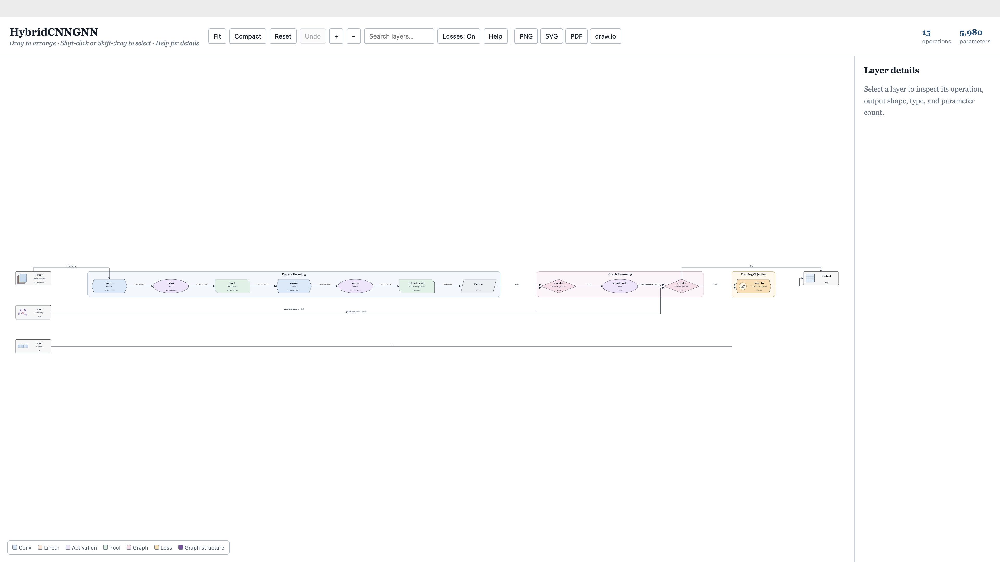
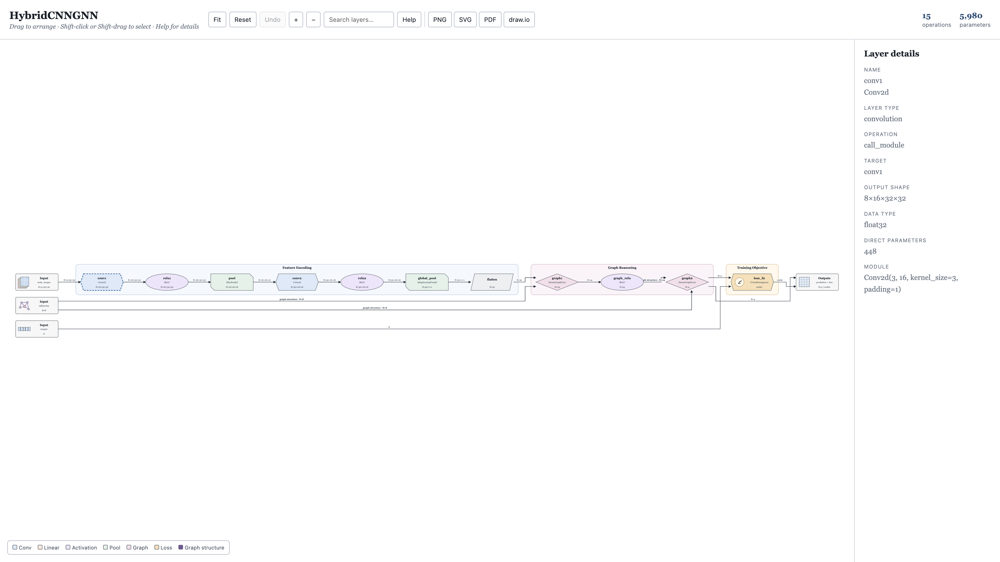
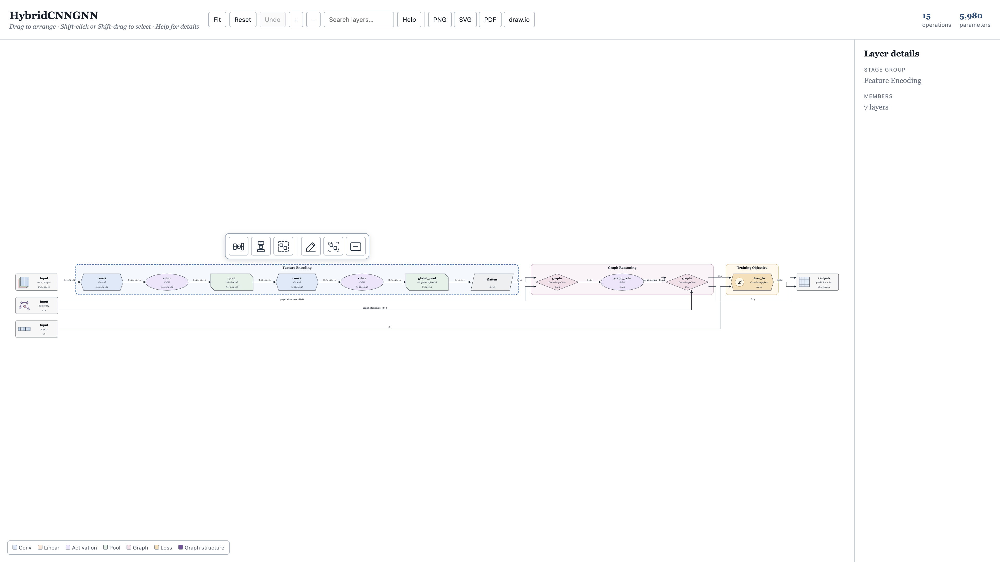

# ModViz

Turn a PyTorch model into a **self-contained interactive HTML** network-flow diagram — ops, shapes, dtypes, parameter counts, and stage panels ready for papers or slides.



Package name: `torch-flow-viz`. Open any generated HTML and click **Help** for the full in-diagram guide.

## Features

| | |
|---|---|
| **Trace** | `torch.fx` data-flow (not just nested modules) |
| **Arrange** | Drag layers / stages · Shift-click or marquee select · Align · Group / Minimize |
| **Compact** | Repack visible nodes and minimized groups to remove unused rows and columns |
| **Inspect** | Click a layer for shape, dtype, params, and module details |
| **Loss view** | Toggle loss nodes, loss-only connections, and their stage panel on/off |
| **Export** | PNG · SVG · PDF · draw.io (full figure, not just the viewport) |
| **Undo** | Layout history with Ctrl/Cmd+Z |





## Install

Python 3.9+ and PyTorch 2.x:

```bash
python -m venv .venv
source .venv/bin/activate
pip install -e .
```

## Quick start

```bash
torch-flow-viz examples/simple_cnn.py \
  --input-shape 1,3,224,224 \
  -o simple_cnn.html
```

Ready-made hybrid demo: open [`examples/hybrid_cnn_gnn_visualization.html`](examples/hybrid_cnn_gnn_visualization.html).

```bash
torch-flow-viz examples/hybrid_cnn_gnn.py --model HybridCNNGNN \
  --input-shape 8,3,32,32 --input-dtype float32 \
  --input-shape 8,8 --input-dtype float32 \
  --input-shape 8 --input-dtype int64 \
  -o examples/hybrid_cnn_gnn_visualization.html
```

## Standalone Python desktop app

The `python` branch includes a native desktop application with an embedded
diagram editor. Install the desktop extra:

```bash
pip install -e '.[desktop]'
```

Start the application and choose **Open model…**:

```bash
torch-flow-viz-desktop
```

Or open a model file immediately:

```bash
torch-flow-viz-desktop examples/simple_cnn.py
```

When no model is open, the welcome screen lists up to eight recent Python models
or saved ModViz diagrams. Use **Save…** (Ctrl/Cmd+S) to choose an `.html` file.
The self-contained file includes the current positions, groups, minimized
stages, loss visibility, and viewport. Open it later from **Open model…**, the
recent-files list, or directly from the command line:

```bash
torch-flow-viz-desktop saved_diagram.html
```

The setup window accepts the model class/factory name, JSON constructor
arguments, one example input shape per line, matching dtypes, and the tracing
device. The resulting editor runs inside the Python application and supports
the same dragging, selection, grouping, minimizing, loss visibility, Compact,
Undo, PNG/SVG/PDF/draw.io export, and HTML saving as the browser version.

The desktop app recognizes the Hierarchical Vessel GNN project when opening
`vessel_gnn/model.py`. It automatically reads the neighboring `config.yaml`,
uses a representative PyTorch Geometric graph, preserves the hard coarsening
stages, and includes only the losses defined by that project. No tensor-input
setup is required for this adapter.

## Your own model

Expose `model = MyNetwork()` in a `.py` file, or point at a class:

```bash
torch-flow-viz my_network.py --model ResNet \
  --init-args '{"num_classes": 5}' \
  --input-shape 1,3,224,224 -o resnet.html
```

Repeat `--input-shape` / `--input-dtype` for multiple inputs. From Python:

```python
from torch_flow_viz import visualize
visualize(model, [torch.zeros(1, 3, 224, 224)], "network.html")
```

Losses appear only if they are part of `forward`. When losses are present, use
**Losses: On/Off** in the toolbar to hide or restore their cells, connections,
and stage panel. All export formats follow the current loss visibility state.
Loading a model file **executes** its Python — use trusted local sources. Models
with heavy data-dependent control flow may need an FX leaf wrap.
